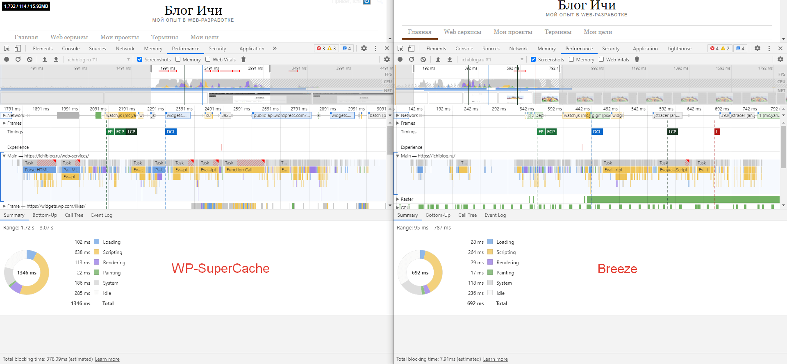
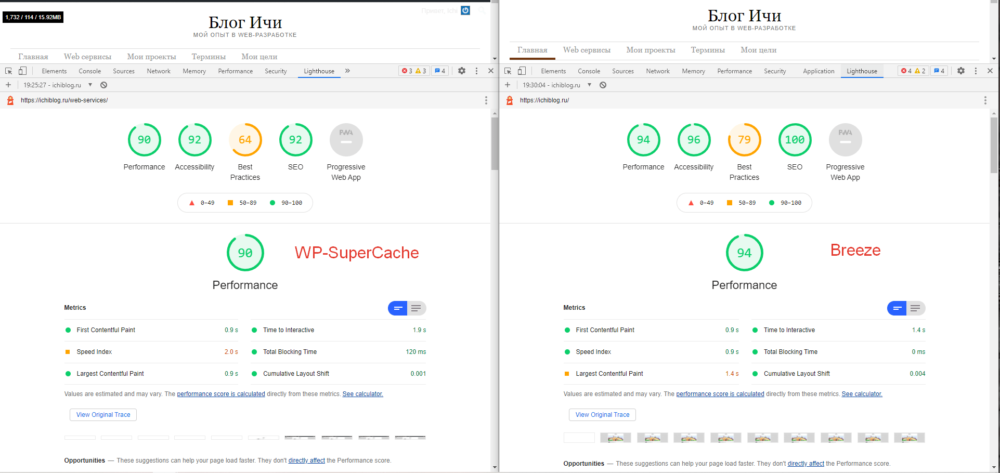
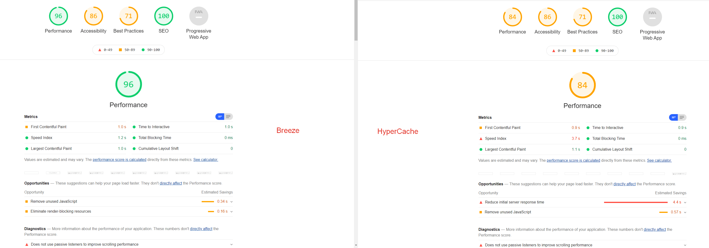

# Плагин кэширования Breeze

WordPress довольно неповоротливый. И с каждым активированным плагином становится всё неповоротливее. Поэтому иногда скорость генерации страниц бывает очень большим.

Мне иногда прилетают ошибки от Yandex.WebMaster со списком страниц, которые открываются долее 3 секунд. Особенно с одного сайте, где установлено куча различных плагинов по просьбе автора.

Подобные проблемы можно решить двумя способами:

* Убрать плагины и сделать нужный функционал вручную. В моем случае — это нецелесообразно. У меня не хватает знаний, а нанимать программиста для реализации функционала сайта, который не приносит денег — нерентабельно.
* Использовать системы кэширования.

Обычно, я использовал плагин [WP-SuperCache](https://ichiblog.ru/wordpress-plugin-wp-super-cache/), старый и неплохой плагин. Пару-тройку лет был одним из лучших. Ну или самым популярным.

Соответственно, он у меня почти на всех сайтах, где используется WordPress, установлен.

Но сейчас есть решения лучше. Одно из таких решений — плагин Breeze. В работе он очень простой — просто устанавливаем и активируем. Я ещё поставил минификацию файлов для незарегистрированных пользователей.

Ссылка на плагин: [Breeze](https://ru.wordpress.org/plugins/breeze/).

Ну и немного статистики для подтверждения слов:

<SiteInfo name="Мой блог" url="https://ichiblog.ru" preview="/preview_site/ichiblog.ru.png" />

На мой блог был установлен плагин WP-SuperCache. Скорость главной страницы выросла в два раза. Также несколько поднялись параметры качества страниц.

На другом сайте у меня был установлен HyperCache. Он позволял использовать кэширование не только сервера, но и клиента. Но тут иногда тупил и генерация кэша происходила довольно долго. А без кэширования страницы могут открываться до 5-7 секунд.

Смотрим результат сравнения на скрине:

Скорость загрузки страницы в обоих случаях примерно 1400-1500 мс, но качество самих страниц немного подросло.

## Дополнено 19.10.2026: Breeze на VPS с nginx + полные замеры

Поставил Breeze ещё на один сайт (VPS с CloudPanel, nginx, PHP 8.5, ~2300 записей и 17 активных плагинов). И наступил на классические грабли, о которых мало кто пишет:

* **Breeze молчал, хотя был настроен.** Причина: в wp-config.php отсутствовала `define('WP_CACHE', true);`. Без этой константы WordPress вообще не подключает файл `advanced-cache.php`, который создаёт Breeze. «Здоровье сайта» при этом честно сообщало «кеширование страницы не обнаружено». Константа должна добавляться автоматически при сохранении настроек, но на старом мигрированном конфиге этого не произошло — проверьте вручную.
* **Кэш лежит не там.** В Breeze 1.10 страничный кэш хранится в `wp-content/cache/breeze/`, а не в `breeze-minification-cache` (та папка — только минификация). Служебный заголовок у отдаваемых страниц — `cache-provider: CLOUDWAYS-CACHE-DE`.

После включения константы прогнал полноценные замеры (ab, 500 запросов, 10 потоков, замер с сервера):

| Режим | Запросов/сек | TTFB (медиана) |
|---|---|---|
| Без кэша | 2,4 | 3 025 мс |
| Breeze | **156,8** | **23 мс** |

То есть Breeze на этом сайте ускорил отдачу в ~65 раз по TTFB и поднял потолок нагрузки с 2,4 до 157 запросов в секунду. Процессор под нагрузкой был занят на 10% (против 95% без кэша). Дальше стало интересно: я добавил перед сайтом ещё и Varnish — получилось уже 204 запроса/сек. А заодно проверил WP Fastest Cache из хостинг-инструкций — он оказался втрое медленнее связки и закэшировал экран согласия. Полный разбор всех шести режимов, включая Varnish и подводные камни — в статье [Кэширование WordPress: замеры шести режимов](./caching.md).
