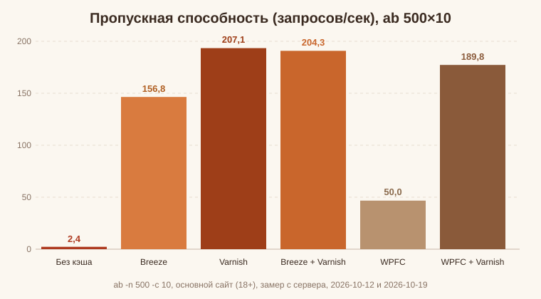
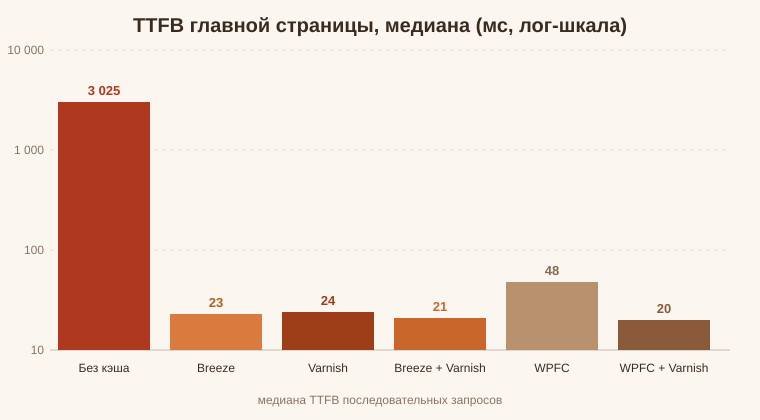

# Кеширование WordPress: Breeze, Varnish и WP Fastest Cache — замеры шести режимов на живом сайте

Хостинговые статьи про оптимизацию WordPress обычно обещают от кэширования «ускорение в 2–3 раза». Захотелось настоящих цифр: я взял рабочий сайт (VPS с CloudPanel, Debian, nginx, PHP 8.5, ~2300 записей и 17 активных плагинов) и прогнал через шесть конфигураций один и тот же нагрузочный тест — от полностью отключённого кэширования до связки плагина с Varnish. Результат оказался в ~35 раз интереснее обещаний, а заодно вскрылись грабли, о которых в таких статьях не пишут.

## Стенд и методика

* Сайт: WordPress с ~2300 записями, 17 активными плагинами, PHP 8.5, nginx + PHP-FPM.
* Сервер: VPS 3,8 ГБ ОЗУ, NVMe-диск. Замеры — с самого сервера через боевой адрес, чтобы отсечь сеть.
* Нагрузка: `ab -n 500 -c 10` (500 запросов, 10 параллельно) плюс последовательные запросы главной и внутренней страницы.
* Параллельно с нагрузкой собирались vmstat/iostat (процессор, диск) и free (память).
* Шесть режимов: без кэша; Breeze; Varnish; Breeze + Varnish; WP Fastest Cache; WPFC + Varnish.

Одинаковый сценарий для всех режимов — главное условие честного сравнения. Между режимами кэши чистились, заголовки ответов контролировались (`X-Cache: HIT/MISS` у Varnish, `cache-provider` у Breeze).

## Результаты: шесть режимов одной таблицей

| Режим | Запросов/сек | TTFB главной, медиана | TTFB внутр., среднее | ab: p95 | ab: p99 | CPU занято | ОЗУ used |
|---|---|---|---|---|---|---|---|
| Без кэша | 2,4 | 3 025 мс | 7,7 с | 5 329 мс | 6 927 мс | 95,5 % | 2 710 МБ |
| Breeze | 156,8 | 23 мс | 0,027 с | 103 мс | 142 мс | 10,2 % | 2 151 МБ |
| Varnish | 207,1 | 24 мс | 0,032 с | **70 мс** | 157 мс | 10,1 % | 2 217 МБ |
| Breeze + Varnish | 204,3 | **21 мс** | 0,022 с | 78 мс | **90 мс** | 10,0 % | 2 150 МБ |
| WP Fastest Cache | 50,0 | 48 мс | 0,045 с | 274 мс | 339 мс | 17,2 % | 2 242 МБ |
| WPFC + Varnish | 189,8 | 20 мс | 0,024 с | 104 мс | 122 мс | 10,1 % | 2 179 МБ |

Ошибок запросов нет ни в одном режиме. TTFB главной — медиана последовательных запросов; «внутр.» — среднее по тестовой записи; CPU — занято под нагрузкой (us+sy); ОЗУ — used после нагрузки. Новый плагин добавляется одной строкой.

Без кэша сервер упирался в процессор: 95,5 % CPU выжигали всего десять «посетителей», TTFB гулял от 1,3 до 8,7 секунд. Любой кэш снижал потребление процессора до ~10 % при нагрузке в 85 раз выше. Диск во всех режимах простаивал (занятость ≤ 1,4 %) — узким местом он не был нигде.

## Холодный старт

«Горячие» цифры красивы, но каждый URL первый раз за TTL всё равно рендерится живьём. Парные замеры «сбросили оба кэша → 1 запрос» в одном часовом окне:

* Breeze + Varnish: 0,69 / 0,73 / 0,77 / 0,89 с (медиана ≈ 0,75 с)
* WPFC + Varnish: 0,55 / 0,57 / 0,57 / 0,94 с (медиана ≈ 0,57 с)

Холодный запрос у обоих стеков почти одинаков — WPFC на ~0,1 с быстрее, потому что при промахе делает меньше обработки. Важный нюанс: в первый день я намерил у Breeze холодные 2–3 секунды — и это оказался артефакт (замер шёл сразу после перезапусков сервисов, OPcache был холодный). Если измеряете кэш — меряйте все режимы подряд в одном окне и обязательно с прогретым OPcache.

## Breeze: плюсы и минусы

Подробности установки и грабли — в статье [Плагин кэширования Breeze](./breeze.md).

Плюсы:

* 157 запросов/сек против 2,4 без кэша — TTFB с трёх секунд падает до 23 мс.
* Минификация HTML/CSS/JS и откладывание JS (delay-js) из коробки.
* Уважает `DONOTCACHEPAGE`: страницы, которые этого захотели, не кэшируются.
* Чистит свой кэш при сохранении записей и комментариев, умеет слать purge в Varnish.

Минусы:

* **Без `define('WP_CACHE', true)` в wp-config.php молчит совсем** — и «Здоровье сайта» покажет «кеширование не обнаружено». Константа должна добавляться при сохранении настроек, но проверьте.
* Отдача кэша идёт через PHP — это ~157 RPS потолок, дальше только Varnish.
* В версии 1.10 кэш лежит в `wp-content/cache/breeze/`, а не в `breeze-minification-cache` — не ищите файлы не там.

## Varnish: плюсы и минусы

Полный VCL для WordPress и настройка очистки — в статье [Varnish для WordPress](./varnish.md).

Плюсы:

* 207 запросов/сек — лучший результат теста; p95 70 мс.
* Не тратит ни процессора на PHP, ни заметной памяти (кэш в malloc 256 МБ).

Минусы:

* Нужен свой VCL: кто кэшируется (анонимные GET без cookie), что не кэшируется (wp-admin, feed, страницы с cookie), на сколько (TTL). Без этого Varnish либо ничего не кэширует, либо кэширует лишнее.
* Очистку при обновлении контента никто за вас не сделает: нужно принимать PURGE-запросы (или bans) из WordPress — плагины шлют их в разных форматах (Breeze, например, использует методы `URLPURGE` и `PURGE`).
* Хранит кэш в ОЗУ — рестарт сбрасывает его целиком.

## Breeze + Varnish: почему связка

Скорость связки (204 RPS) статистически не отличается от чистого Varnish (207). Но:

* Varnish кэширует уже минифицированный HTML от Breeze, а посетители с cookie (комментаторы, согласившиеся с экраном), которых Varnish пропускает мимо, получают от Breeze то же быстрое кэшированное.
* Если Varnish перезапустится и сбросит ОЗУ-кэш, гостей встретит кэш Breeze — просадки нет.
* Хвост p99 у связки лучший в тесте: 90 мс против 157 мс у чистого Varnish.

## WP Fastest Cache: плюсы и минусы

Разбор в отдельной статье — [WP Fastest Cache](./wp-fastest-cache.md).

Плюсы:

* Простейший интерфейс, кэш включается одной галочкой.
* На «горячих» запросах работает: TTFB 48 мс, 50 запросов/сек — это ~20 раз быстрее безкэшевого рендера.
* Самый быстрый холодный промах в тесте (0,55–0,94 с — при промахе делает меньше обработки, чем Breeze).

Минусы:

* **Втрое медленнее связки Breeze + Varnish** (50 против 204 RPS, p95 274 против 78 мс). На nginx он вынужден отдавать кэш через PHP: его фирменная быстрая отдача работает через mod_rewrite в .htaccess, которого nginx не читает. На Apache расклад был бы другим.
* **Игнорирует `DONOTCACHEPAGE`.** На сайте с обязательным экраном согласия он закэшировал сам экран согласия (с вшитым CSRF-токеном) и раздавал его всем посетителям — форма согласия переставала работать. Breeze и Varnish этот заголовок уважают.
* Кэш хранит в `wp-content/cache/all/`, чистится по расписанию или вручную.

## Экран согласия против кэша

Отдельная история: на сайте стоит обязательный экран согласия (18+), и он объявляет `DONOTCACHEPAGE`. Пока экран обязателен:

* Breeze не кэширует страницы вовсе — и «горячие» цифры из таблицы не действуют: каждый просмотр рендерится живьём (~0,7–3 с).
* Varnish кэшировать экран тоже нельзя — он ставит cookie, и закэшированная версия ломает форму согласия.

То есть выбор «кэш или гейт» — это продуктовое решение, а не техническое. Пути примирения: согласие на отдельной странице/поддомене, или JS-гейт поверх полноценно кэшируемого HTML.

### Проверено по отдельности и под нагрузкой

Докопано до конца на том же сайте:

* **WP-Optimize тоже уважает `DONOTCACHEPAGE`.** Page-cache включён штатным API плагина — каталог кэша остался пустым, экран согласия не закэшировался, каждый просмотр — живой рендер 0,6–1,5 с. Третья система, подтвердившая запрет (Breeze, Varnish, WP-Optimize); исключение по-прежнему одно — WP Fastest Cache, который при гейте и сломан, и отключён.
* **Изоляция плагинов**: проверил состояния «только Breeze» (WP-Optimize полностью деактивирован) и «только WP-Optimize» (деактивирован Breeze) — идентичный живой рендер 0,62–1,96 с. Плагины друг другу не мешают, гейт блокирует обоих по отдельности.
* **Цена гейта под нагрузкой**: `ab` 500×10 при активном гейте — **1,28 запроса/сек** (средний запрос 7,8 с, p95 18 с, p99 25 с) при том, что load average был всего 0,67. Сервер простаивает (с кэшем при тех же 10 % CPU летело 204 RPS) — узкое место не мощность, а очередь на PHP-воркеры: каждый просмотр рендерится с нуля. Практически это ~4–5 тысяч просмотров в сутки ровно, любой всплеск — и p95 улетает в 18 секунд.

## А если сайт лёгкий? Контрольный эксперимент

Все цифры выше — с тяжёлого сайта (17 плагинов, 2 300+ записей). Для честности я прогнал ту же тройку режимов на противоположном полюсе: небольшой журнал (68 МБ база, ~1 500 постов, 13 плагинов, WP-Optimize с включённым кэшем страниц).

| Режим | Запросов/сек | TTFB (5 замеров) |
|---|---|---|
| Без кэша страниц | 4,8 | 0,30–0,37 с |
| WP-Optimize кэш (боевой) | **174,2** | 15–19 мс |
| Breeze | 164,7 | 17 мс |

Кэш и здесь даёт ~36-кратный прирост RPS и ~20-кратное снижение TTFB — просто в абсолютных
цифрах это незаметно: без кэша TTFB 0,34 с, и посетителю такого сайта хватает. Нюанс первой
версии этого замера: сначала я намерил «без кэша — 16 мс, 187 RPS» — и это была ошибка:
плагин кэша самовосстанавливает свой dropin при первом же запросе, и «отключённый» кэш
продолжал работать. Отключать page cache нужно штатным методом плагина, а не удалением файла.

Практический вывод остаётся: на лёгком сайте ускорение есть в цифрах, но посетитель его
не почувствует (0,34 с против 0,02 с — обе скорости «мгновенные»). Кэш-плагин здесь нужен
ради запаса прочности под нагрузкой, а не ради UX. Полный кейс с найденным багом —
в материалах замеров.

## Грабли, на которые я наступил

* `define('WP_CACHE', true)` — без неё все плагины кэша «advanced-cache»-класса молчат.
* Breeze шлёт purge в Varnish на порт 80, а nginx на http-запросах раньше.location'ов делает редирект на https — purge до Varnish не долетал. Лечится указанием порта Varnish в настройках Breeze (127.0.0.1:6081) и обработкой PURGE в VCL.
* В VCL нельзя проверять отсутствие заголовка сравнением с пустой строкой — `req.http.X-Real-IP == ""` ложно, если заголовка нет; нужно `!req.http.X-Real-IP`.
* wp-cli сохраняет опции с `--format=json` как массив — плагины, ждущие JSON-строку, падают с TypeError. На PHP 8.5 это уже фатальная ошибка всего сайта.
* Любая правка файлов сайта через sudo-wp-cli создаёт их от имени root: PHP-FPM от имени пользователя сайта теряет право записи, а плагины начинают сыпать предупреждениями «файл не доступен для записи». После sudo-сессии — `find /путь/к/сайту -user root -exec chown пользователь:группа {} +`.
* Плагины кэша самовосстанавливают свой dropin: удалил `advanced-cache.php` — первый же запрос вернёт файл на место. «Отключённый» кэш продолжает работать. Отключать page cache нужно штатным методом плагина (у WP-Optimize — `WP_Optimize()->get_page_cache()->disable()`).
* dropin, сгенерированный из wp-cli, получает home_url без https (в CLI нет HTTPS-контекста) — точная проверка раздачи главной не совпадает с https-запросами, и кэш главной мёртв для всех посетителей. Правится http→https в строке сравнения после генерации.

## Выводы

* Любой осмысленный кэш лучше никакого: даже самый медленный участник теста дал ~20-кратное ускорение.
* Максимальная скорость — Varnish, максимальное удобство — Breeze, лучший компромисс — связка: Varnish отдаёт горячее из ОЗУ, Breeze страхует и занимается минификацией.
* WP Fastest Cache — нормальный выбор для Apache-шаред-хостинга, но на nginx + Varnish он теряет смысл.
* На лёгком сайте кэш не нужен вовсе — и это тоже надо проверять, а не верить инструкциям.
* Пока на сайте обязателен экран согласия, любой кэш простаивает — сначала решите, как гейт уживается с кэшем.
* Замеряйте сами: «2–3×» из хостинговых инструкций и реальные 85× на том же железе — разные книги.
